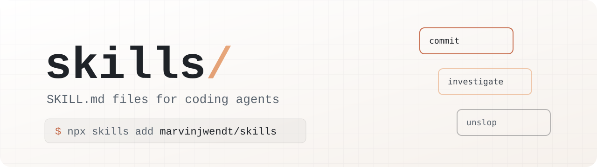

<div align="center">

<picture>
  <source media="(prefers-color-scheme: dark)" srcset="assets/banner-dark.svg">
  
</picture>

<p>
  <a href="https://agentskills.io"></a>
  <a href="skills"></a>
  <a href="https://github.com/MarvinJWendt/skills/commits/main"></a>
  <a href="LICENSE"></a>
</p>

<p>
  <b>Claude Code</b> &nbsp;·&nbsp; <b>Codex</b> &nbsp;·&nbsp; <b>Cursor</b> &nbsp;·&nbsp; <b>Gemini CLI</b> &nbsp;·&nbsp; <b>OpenCode</b> &nbsp;·&nbsp; any agent that reads <code>SKILL.md</code>
</p>

<p>
  <a href="#install">Install</a> &nbsp;|&nbsp;
  <a href="#skills">Skills</a> &nbsp;|&nbsp;
  <a href="#license">License</a>
</p>

</div>

<br>

The agent skills I use every day. They commit, pull and push, chase down failures, edit prose and code comments, and set up repositories for agents. Each one is a single `SKILL.md` in the [Agent Skills](https://agentskills.io) format, and most take a minute to read, so read before you install.

## Install

Pick from the list:

```sh
npx skills add marvinjwendt/skills
```

Or install one skill for every project:

```sh
npx skills add marvinjwendt/skills -s unslop -g
```

<details>
<summary>More ways to install</summary>
<br>

| Command | What it does |
| --- | --- |
| `npx skills add marvinjwendt/skills --list` | Lists the skills, installs nothing |
| `npx skills add marvinjwendt/skills -s commit push` | Installs a few into the current project |
| `npx skills add marvinjwendt/skills -s '*' -g -y` | Installs all of them globally, no prompts |
| `npx skills use marvinjwendt/skills@unslop` | Prints a prompt that uses one skill once, without installing it |

</details>

## Skills

Each skill is one folder under [`skills/`](skills). The command below a skill installs just that one, for every project.

<!-- skills:start -->
[commit](#commit) · [grill-me](#grill-me) · [handoff](#handoff) · [how](#how) · [investigate](#investigate) · [orchestrate](#orchestrate) · [pull](#pull) · [push](#push) · [quick-html](#quick-html) · [set-up-agents](#set-up-agents) · [set-up-agents-md](#set-up-agents-md) · [set-up-skills](#set-up-skills) · [shutdown](#shutdown) · [technical-writing](#technical-writing) · [unslop](#unslop) · [what](#what) · [writing-comments](#writing-comments)

### commit

<sub>[`skills/commit/SKILL.md`](https://github.com/MarvinJWendt/skills/blob/HEAD/skills/commit/SKILL.md)</sub>

Commit the current changes with a message written in the repo's own style. Run it on the user's explicit request or /commit, never because a task just finished.

```sh
npx skills add marvinjwendt/skills -s commit -g
```

### grill-me

<sub>[`skills/grill-me/SKILL.md`](https://github.com/MarvinJWendt/skills/blob/HEAD/skills/grill-me/SKILL.md)</sub>

Grill the user relentlessly about a plan, decision, or idea until both sides share one understanding of it. Use on /grill-me, when the user wants to stress-test their thinking, or on any "grill" trigger phrase.

```sh
npx skills add marvinjwendt/skills -s grill-me -g
```

### handoff

<sub>[`skills/handoff/SKILL.md`](https://github.com/MarvinJWendt/skills/blob/HEAD/skills/handoff/SKILL.md)</sub>

Write a handoff document that summarises the current conversation, so a fresh agent can continue the work. Use when the user asks for a handoff.

```sh
npx skills add marvinjwendt/skills -s handoff -g
```

### how

<sub>[`skills/how/SKILL.md`](https://github.com/MarvinJWendt/skills/blob/HEAD/skills/how/SKILL.md)</sub>

Use for "how does X work", code walkthroughs before changing something, and placement / ownership / layering questions ("where should this live", "which package owns this", "is this the right layer"). Explains subsystem architecture, runtime flow, onboarding mental models.

```sh
npx skills add marvinjwendt/skills -s how -g
```

### investigate

<sub>[`skills/investigate/SKILL.md`](https://github.com/MarvinJWendt/skills/blob/HEAD/skills/investigate/SKILL.md)</sub>

Find out why something failed or behaves the way it does, using read-only commands only, and report the cause back in chat.

```sh
npx skills add marvinjwendt/skills -s investigate -g
```

### orchestrate

<sub>[`skills/orchestrate/SKILL.md`](https://github.com/MarvinJWendt/skills/blob/HEAD/skills/orchestrate/SKILL.md)</sub>

Act as team lead for a batch of parallel tasks, delegate each to a named subagent, then integrate their work and report back.

```sh
npx skills add marvinjwendt/skills -s orchestrate -g
```

### pull

<sub>[`skills/pull/SKILL.md`](https://github.com/MarvinJWendt/skills/blob/HEAD/skills/pull/SKILL.md)</sub>

Bring the current branch up to date by merging its upstream, keeping uncommitted work and both sides of every conflict.

```sh
npx skills add marvinjwendt/skills -s pull -g
```

### push

<sub>[`skills/push/SKILL.md`](https://github.com/MarvinJWendt/skills/blob/HEAD/skills/push/SKILL.md)</sub>

Push the current branch to its remote, committing first when the working tree is dirty. Run it on the user's explicit request or /push, never because a task just finished.

```sh
npx skills add marvinjwendt/skills -s push -g
```

### quick-html

<sub>[`skills/quick-html/SKILL.md`](https://github.com/MarvinJWendt/skills/blob/HEAD/skills/quick-html/SKILL.md)</sub>

Build a single self-contained HTML file with Tailwind and CDN imports, no build step. Reports, local experiment frontends, and debug UIs served by a backend.

```sh
npx skills add marvinjwendt/skills -s quick-html -g
```

### set-up-agents

<sub>[`skills/set-up-agents/SKILL.md`](https://github.com/MarvinJWendt/skills/blob/HEAD/skills/set-up-agents/SKILL.md)</sub>

Set up a repository's whole agent configuration in one go, instructions and skills. Use when asked to set up agents in a repo, to bootstrap a fresh project for agent work, or when it is unclear which parts of the setup a repo is missing.

```sh
npx skills add marvinjwendt/skills -s set-up-agents -g
```

### set-up-agents-md

<sub>[`skills/set-up-agents-md/SKILL.md`](https://github.com/MarvinJWendt/skills/blob/HEAD/skills/set-up-agents-md/SKILL.md)</sub>

Make `AGENTS.md` the single source of truth for a repository's agent instructions and symlink every agent's own instruction file to it. Use when a repo has no agent instructions yet, when they live in `CLAUDE.md` as a real file, or when several instruction files have drifted apart.

```sh
npx skills add marvinjwendt/skills -s set-up-agents-md -g
```

### set-up-skills

<sub>[`skills/set-up-skills/SKILL.md`](https://github.com/MarvinJWendt/skills/blob/HEAD/skills/set-up-skills/SKILL.md)</sub>

Wire a repository's skills so `.agents/skills/` is the single source of truth and every agent reads it through a symlink. Use when a repo has no skill setup yet, when skills sit in `.claude/skills/` as real files, or when a second agent should read the same skills.

```sh
npx skills add marvinjwendt/skills -s set-up-skills -g
```

### shutdown

<sub>[`skills/shutdown/SKILL.md`](https://github.com/MarvinJWendt/skills/blob/HEAD/skills/shutdown/SKILL.md)</sub>

Shut the computer down once every other task in the session is finished. For long unattended sessions while the user sleeps.

```sh
npx skills add marvinjwendt/skills -s shutdown -g
```

### technical-writing

<sub>[`skills/technical-writing/SKILL.md`](https://github.com/MarvinJWendt/skills/blob/HEAD/skills/technical-writing/SKILL.md)</sub>

Layered technical-writing standard: text size and scope, Diátaxis structure, Google developer style sentences, STE instruction rules, Global English syntax. Use for /technical-writing and when writing or reviewing any technical English text: PR descriptions, docs, readmes, guides, RFCs and design docs, release notes, CLI help, error strings, doc comments.

```sh
npx skills add marvinjwendt/skills -s technical-writing -g
```

### unslop

<sub>[`skills/unslop/SKILL.md`](https://github.com/MarvinJWendt/skills/blob/HEAD/skills/unslop/SKILL.md)</sub>

Cut AI tells from prose and give it a human voice. Load before writing or editing prose that lands in a file (markdown, HTML, README, docs, changelog, commit body, doc comment), and on a direct /unslop call against a target, such as "/unslop your last message" or "/unslop this document".

```sh
npx skills add marvinjwendt/skills -s unslop -g
```

### what

<sub>[`skills/what/SKILL.md`](https://github.com/MarvinJWendt/skills/blob/HEAD/skills/what/SKILL.md)</sub>

Re-explain your last message, simpler and with more detail. Type it again to go a level deeper.

```sh
npx skills add marvinjwendt/skills -s what -g
```

### writing-comments

<sub>[`skills/writing-comments/SKILL.md`](https://github.com/MarvinJWendt/skills/blob/HEAD/skills/writing-comments/SKILL.md)</sub>

How code comments get written: what earns one, how it reads, the sediment to keep out, and the passes it goes through. Load before you write or change any comment in a source file, including doc comments (godoc, JSDoc, docstrings), file headers and TODO markers; when porting, renaming or retiring a predecessor, where comments turn into changelogs; when auditing the comments already in a file; and whenever you weigh whether something needs a comment at all.

```sh
npx skills add marvinjwendt/skills -s writing-comments -g
```
<!-- skills:end -->

<!-- forked-skills:start -->
<!-- forked-skills:end -->

## License

[MIT](LICENSE), except for forked skills, which keep the license in their own directory.
