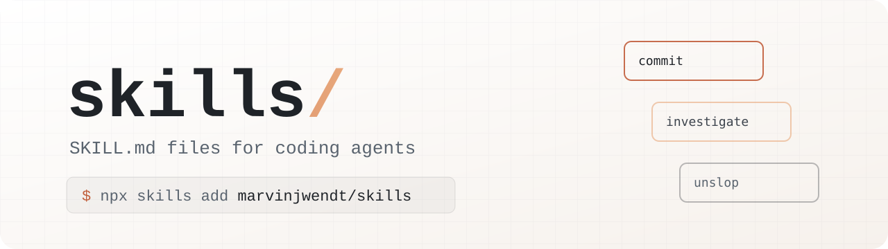

<div align="center">

<picture>
  <source media="(prefers-color-scheme: dark)" srcset="assets/banner-dark.svg">
  
</picture>

<p>
  <a href="https://agentskills.io"></a>
  <a href="skills"></a>
  <a href="https://github.com/MarvinJWendt/skills/commits/main"></a>
  <a href="LICENSE"></a>
</p>

<p>
  <b>Claude Code</b> &nbsp;·&nbsp; <b>Codex</b> &nbsp;·&nbsp; <b>Cursor</b> &nbsp;·&nbsp; <b>Gemini CLI</b> &nbsp;·&nbsp; <b>OpenCode</b> &nbsp;·&nbsp; any agent that reads <code>SKILL.md</code>
</p>

<p>
  <a href="#install">Install</a> &nbsp;|&nbsp;
  <a href="#skills">Skills</a> &nbsp;|&nbsp;
  <a href="#license">License</a>
</p>

</div>

<br>

The agent skills I use every day. They commit, pull and push, chase down failures, edit prose and code comments, and set up repositories for agents. Each one is a single `SKILL.md` in the [Agent Skills](https://agentskills.io) format, and most take a minute to read, so read before you install.

## Install

Pick from the list:

```sh
npx skills add marvinjwendt/skills
```

Or install one skill for every project:

```sh
npx skills add marvinjwendt/skills -s unslop -g
```

<details>
<summary>More ways to install</summary>
<br>

| Command | What it does |
| --- | --- |
| `npx skills add marvinjwendt/skills --list` | Lists the skills, installs nothing |
| `npx skills add marvinjwendt/skills -s commit push` | Installs a few into the current project |
| `npx skills add marvinjwendt/skills -s '*' -g -y` | Installs all of them globally, no prompts |
| `npx skills use marvinjwendt/skills@unslop` | Prints a prompt that uses one skill once, without installing it |

</details>

## Skills

Click a name to read the whole file.

<!-- skills:start -->
<table>
<tr><th>Skill</th><th>What it does</th></tr>
<tr><td><a href="skills/commit"><code>commit</code></a></td><td>Commit the current changes with a message written in the repo's own style.</td></tr>
<tr><td><a href="skills/handoff"><code>handoff</code></a></td><td>Write a handoff document that summarises the current conversation, so a fresh agent can continue the work.</td></tr>
<tr><td><a href="skills/how"><code>how</code></a></td><td>Use for "how does X work", code walkthroughs before changing something, and placement / ownership / layering questions ("where should this live", "which package owns this", "is this the right layer").</td></tr>
<tr><td><a href="skills/investigate"><code>investigate</code></a></td><td>Find out why something failed or behaves the way it does, using read-only commands only, and report the cause back in chat.</td></tr>
<tr><td><a href="skills/pull"><code>pull</code></a></td><td>Bring the current branch up to date by merging its upstream, keeping uncommitted work and both sides of every conflict.</td></tr>
<tr><td><a href="skills/push"><code>push</code></a></td><td>Push the current branch to its remote, committing first when the working tree is dirty.</td></tr>
<tr><td><a href="skills/quick-html"><code>quick-html</code></a></td><td>Build a single self-contained HTML file with Tailwind and CDN imports, no build step.</td></tr>
<tr><td><a href="skills/set-up-agents"><code>set-up-agents</code></a></td><td>Set up a repository's whole agent configuration in one go, instructions and skills.</td></tr>
<tr><td><a href="skills/set-up-agents-md"><code>set-up-agents-md</code></a></td><td>Make `AGENTS.md` the single source of truth for a repository's agent instructions and symlink every agent's own instruction file to it.</td></tr>
<tr><td><a href="skills/set-up-skills"><code>set-up-skills</code></a></td><td>Wire a repository's skills so `.agents/skills/` is the single source of truth and every agent reads it through a symlink.</td></tr>
<tr><td><a href="skills/shutdown"><code>shutdown</code></a></td><td>Shut the computer down once every other task in the session is finished.</td></tr>
<tr><td><a href="skills/technical-writing"><code>technical-writing</code></a></td><td>Layered technical-writing standard: text size and scope, Diátaxis structure, Google developer style sentences, STE instruction rules, Global English syntax.</td></tr>
<tr><td><a href="skills/unslop"><code>unslop</code></a></td><td>Cut AI tells from prose and give it a human voice.</td></tr>
<tr><td><a href="skills/what"><code>what</code></a></td><td>Re-explain your last message, simpler and with more detail.</td></tr>
<tr><td><a href="skills/writing-comments"><code>writing-comments</code></a></td><td>How code comments get written: what earns one, how it reads, the sediment to keep out, and the passes it goes through.</td></tr>
</table>
<!-- skills:end -->

<!-- forked-skills:start -->
<!-- forked-skills:end -->

## License

[MIT](LICENSE), except for forked skills, which keep the license in their own directory.
